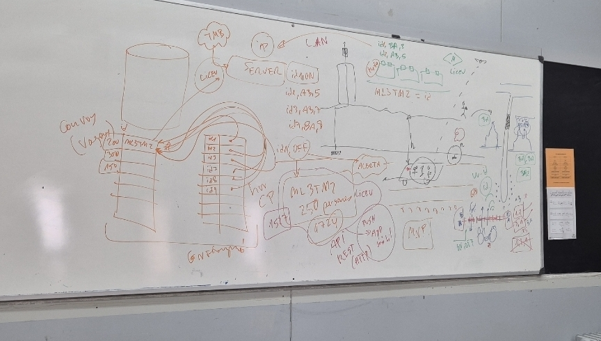

#  Metrocount
Desenvolupament d'una aplicacio per saber la quantitat que tan ple va el metro de Barcelona
 

## Links

[Documentació de la API de TMB "Incluyent autobusos"](https://developer.tmb.cat/api-docs/v1 )

[Més dades per consultar de la API de TMB"](https://developer.tmb.cat/data)

## Context

La nostra idea es fer-hi en Python una demostració de com es podria fer un comptador de persones en els vagons del metro de Barcelona perquè aixì a traves d'una aplicació es pogues consultar que tan ocupat va el metro

