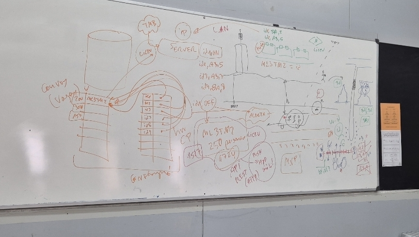
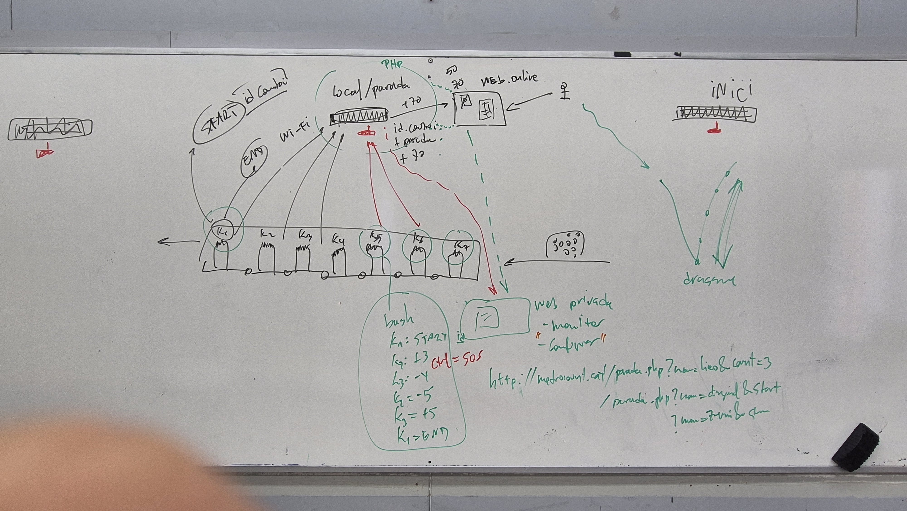

#Metrocount

## Links

[Documentació de la API de TMB "Incluyent autobusos"](https://developer.tmb.cat/api-docs/v1 )

[Més dades per consultar de la API de TMB"](https://developer.tmb.cat/data)

## Context

El nostre projecte de Metrocount s'emmarca com si fóssim uns treballadors de TMB (Transports Metropolitans de Barcelona) i volem implementar un sistema informàtic en unes plaques (per definir) capaç de comptar persones en els vagons del metro>

## Descripció

El nostre sistema el que aportaria seria que les persones poguessin veure quantes persones hi ha en els vagons, això resoldria el problema que tenen dubtes sobre que tan ple van els vagons i si és millor agafar el metro o esperar-se a q>

Pel nostre sistema havíem pensat a implementar una sèrie de tecnologies com seria uns sensors infrarojos en les portes del vagó perquè així hi puguin comptar quantes persones entren, un codi que es comuniqui amb els infrarojos i que sigui capaç de communicar-se perqué així poguin comptar les persones que hi entren i emmagatzemar-se perque es mostrin en una interficie i un servidor que mostri l'informació.>

Aquest sistema estaria enfocat per aquelles persones que utilitzen el metro d'una manera regular i activa i es volen estalviar estar en vagons on hi està ple de gent. 

## Problemes i fora d'abast

Els problemes d'abast en els quals ens podríem arribar a trobar és la precisió d'aquestes dades, un dels principals reptes d'aquest projecte és que les dades no podran ser 100% precises quan hi ha molta gent intentant entrar al metro o p>

També en la part de recollida de dades els repetidors de wifi que hi ha que serveixen per enviar les dades cap al servidor sobre les persones podria fallar per culpa de l'alta demanda de persones que utilitzessin la xarxa 

El que entra en el projecte és el hardware i com estarà dissenyat la placa i la seva programació, però no el xassís i disseny, només tota la lògica i programació que hi ha dintre. 

